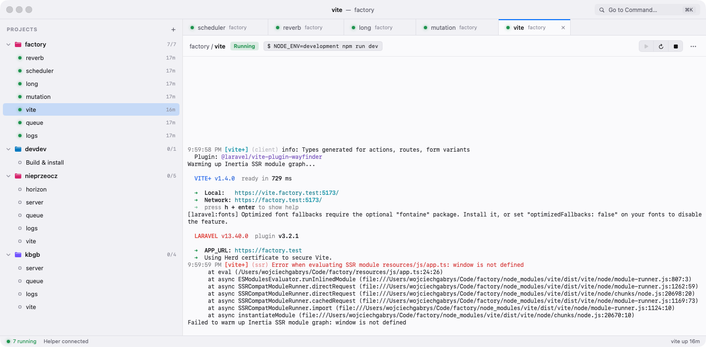

# devdev



A native macOS app that starts, stops and watches the dev servers a web project needs, such as `npm run dev` or `php artisan queue:listen`.

You define **Projects**, give each a list of **Commands**, and control them from the main window, a menubar panel, or an AI agent over MCP.

## Features

- **One place for every dev process.** Start, stop and restart one Command, or a whole Project with Start All, Stop All and Restart All.
- **Real terminal output.** Each Command runs in a pseudo-terminal, so colours and redraws look as they do in a terminal. Output is read-only.
- **Discovery.** Adding a Laravel or Node folder proposes Commands for it: `php artisan dev:list` when available, otherwise `serve`, `queue:listen`, `schedule:work`, `pail`, `horizon`, `reverb:start`, and the `dev` script from `package.json`. You confirm every proposal.
- **Auto-restart** after a crash, paused after 5 crashes in 60 seconds.
- **Restart when files change**, matched against globs per Command, after 0.5 seconds of quiet.
- **Menubar panel** with a filter, per-Project actions, and a red badge while any Command is Crashed.
- **Notifications** for crashes, and for starts, restarts and stops made by an agent, auto-restart or a file change.
- **MCP server** (`devdev mcp`) so an agent can list Projects, control Commands and read or search their output.

## Requirements

- macOS 26
- Xcode with the macOS 26 SDK

devdev is a personal tool. It is built locally, with no sandbox, signing, notarization or auto-update.

## How it fits together

| Program | What it is |
|---|---|
| **Helper** | A background app with no Dock icon. It owns every Process, the output buffers, the saved configuration, the menubar icon and notifications. It keeps running after the App quits. |
| **App** | The Dock app with the main window. It holds nothing durable and talks to the Helper. |
| **`devdev` CLI** | Bundled inside the App. `devdev mcp` is an MCP server over stdio that talks to the Helper. |

Clients reach the Helper over a Unix domain socket in `~/Library/Application Support/devdev/`. The configuration file lives there too, and only the Helper writes it. See [docs/adr/0001-helper-owns-processes.md](docs/adr/0001-helper-owns-processes.md) for why.

## Build and test

From the repo root:

```bash
xcodebuild -project devdev.xcodeproj -scheme devdev -resolvePackageDependencies
xcodebuild -project devdev.xcodeproj -scheme devdev -destination platform=macOS build
xcodebuild -project devdev.xcodeproj -scheme devdev -destination platform=macOS test
```

For a faster loop on the core logic:

```bash
cd Packages/DevDevCore && swift test
```

## Install

```bash
scripts/install.sh
```

This builds the Release configuration and copies `devdev.app` to `/Applications`. Pass another folder as the first argument to install elsewhere. A running Helper is left alone; the App shows a banner when it is outdated.

## Use with an AI agent

Open **Settings** in devdev and copy the MCP setup line. For an install in `/Applications` it looks like this:

```bash
claude mcp add devdev -- "/Applications/devdev.app/Contents/Helpers/devdev" mcp
```

A Debug build registers as `devdev-debug`, so it never replaces the daily one.

| Tool | Does |
|---|---|
| `list_projects` | Every Project with its folder and status |
| `get_project` | One Project's Commands with status and last exit |
| `start_command`, `stop_command`, `restart_command` | Act on one Command by name |
| `start_all`, `stop_all`, `restart_all` | Act on a whole Project |
| `get_output` | The last N lines of a Command's output, as plain text |
| `search_output` | Output lines matching a pattern, with context |

Every tool takes an optional `project`. Without it, devdev uses the Project whose folder holds the agent's working directory. Agents can control and read, but cannot create, edit or delete Projects or Commands.

## Keyboard shortcuts

| Keys | Action |
|---|---|
| <kbd>⌘</kbd> <kbd>K</kbd> | Go to Command |
| <kbd>⌘</kbd> <kbd>W</kbd> | Close the selected tab, or the window when no tab is open |
| <kbd>⌘</kbd> <kbd>1</kbd> … <kbd>9</kbd> | Show a tab by its place from the left |
| <kbd>⌘</kbd> <kbd>0</kbd> | Show the last tab |
| <kbd>⌘</kbd> <kbd>⇧</kbd> <kbd>[</kbd> / <kbd>]</kbd> | Previous or next tab |

A middle click on a tab closes it.

## Repository layout

| Path | Contents |
|---|---|
| `App/` | The main window app |
| `Helper/` | The background Helper and menubar panel |
| `CLI/` | The `devdev` command-line tool |
| `Packages/DevDevCore/` | Every rule and protocol, with tests |
| `docs/` | The spec, ADRs and checklists |
| `knowledge/` | Project knowledge, generated by Factory. Do not edit by hand. |
| `GLOSSARY.md` | The words devdev uses, and the ones it avoids |

The full behaviour is specified in [docs/spec.md](docs/spec.md).
